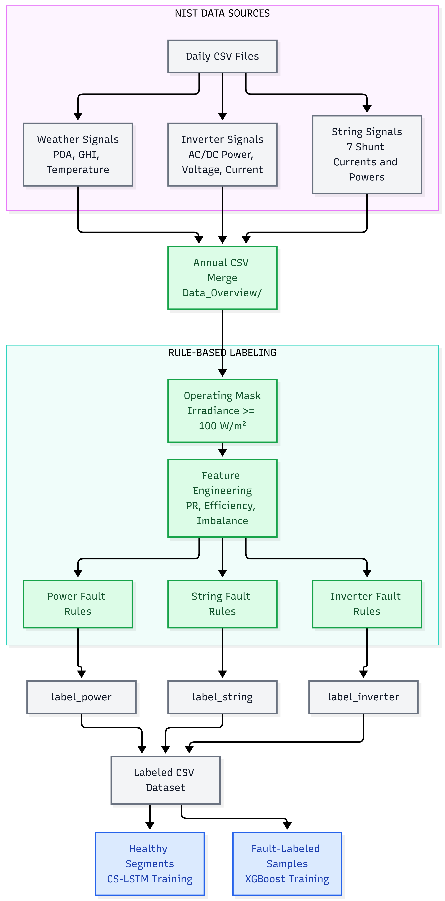
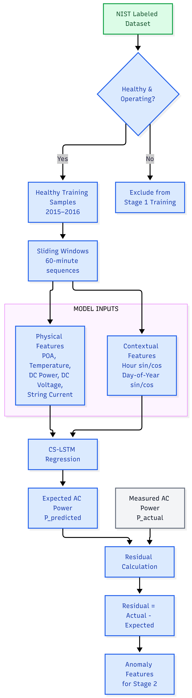

# Architecture notes

See the [architecture overview](../images/architecture.svg) for the full data and model flow. The [Mermaid source](../images/architecture.mmd) defines the overview. The thesis [methodology](main.tex) describes the planned forecasting and degradation heads.

## Fault labeling

The operating mask in `scripts/operating.py` is active when the site-specific irradiance exceeds 100 W/m². The pipeline exports the three labels with each timestamp. See the [data labeling guide](data-labeling.md) for the workflow and quality checks.

## Stage 1 CS-LSTM regression

The Stage 1 notebook prototype fits on healthy operating samples. The trained model estimates expected AC power, and the measured-minus-expected residual feeds the binary XGBoost prototype. See the [chronological split](../README.md#chronological-split) for the training, validation, and held-out test years.
